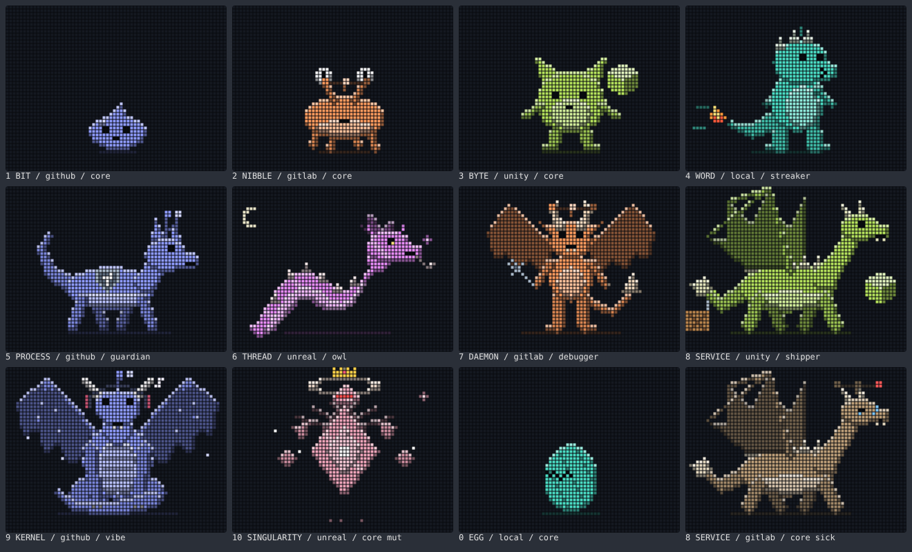
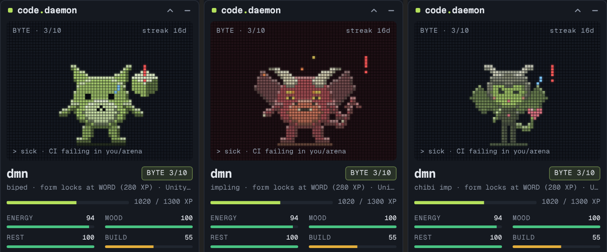

# code.daemon

A pixel pet for Windows that grows from your coding habits. It reads your commits, CI results and releases from GitHub and GitLab, then hatches, evolves and changes form based on how you actually work.

## What's here

| Path | What it is |
| --- | --- |
| `CodeDaemon.ps1` | Widget host: frameless always-on-top window (PowerShell 5.1 + Edge WebView2), tray icon, DPAPI-encrypted tokens, GitHub/GitLab API proxy |
| `ui/widget.html`, `ui/widget.js` | Widget UI: pet screen, vitals, Feed / Log / Setup panel |
| `ui/pet-core.js` | Shared pet engine: XP, stages, forms, mutations, CI health, pixel renderer, SVG card |
| `ui/themes/` | Sprite themes (Demonic, Succubus), generated from the sheets in `sprites/` |
| `sprites/` | Source sprite sheets: 11 stages × 4 frames of 64 × 48 |
| `github-profile/` | GitHub Action that puts the same pet, animated, on your GitHub profile |
| `lib/` | Microsoft WebView2 SDK (WinForms) and native loaders |

## Run the widget

1. Double-click `Start code.daemon.vbs`. The pet appears in the bottom-right corner, with a tray icon.
2. In **Setup**, paste a GitHub token (classic, `repo` scope) and/or a GitLab token (`read_api` + `read_user`).
3. The first scan reads 180 days. After that it rescans every 15 minutes.

If nothing appears, run `Start code.daemon (debug).cmd` to see errors. Requires Windows 10/11 with the WebView2 Runtime.

## How the pet grows

- **XP per session**: commits in one repo less than 2 hours apart form a session. A session earns `12·ln(1 + minutes/20) + 7·√commits` (minutes up to 480, commits up to 50), plus 8 for tests, 6 for a bug fix and 15 for a release. Long sessions and commit bursts grow slowly on purpose.
- **Streak**: +3% per consecutive coding day, up to +30%.
- **Daily soft cap**: past 90 XP in a day, extra XP counts at 15%. Marathon days still count, they just can't carry the pet alone.
- **CI**: turning a red build green earns +15 XP.

| Stage | XP | Body |
| --- | ---: | --- |
| 0 EGG | 0 | Egg |
| 1 BIT | 60 | Slime droplet |
| 2 NIBBLE | 250 | Crawler with eye stalks |
| 3 BYTE | 650 | Round biped |
| 4 WORD | 1,300 | Little kaiju with a tail |
| 5 PROCESS | 2,300 | Four-legged runner |
| 6 THREAD | 3,800 | Slithering wyrm |
| 7 DAEMON | 5,800 | Winged imp |
| 8 SERVICE | 8,500 | Wyvern |
| 9 KERNEL | 13,000 | Great dragon |
| 10 SINGULARITY | 30,000 | Ascended form |

Rough pace: a heavy daily vibe-coding habit reaches KERNEL in about 6 months and SINGULARITY in about 9; one solid session on weekdays reaches SERVICE in about a year.

- **Crest** (from NIBBLE): the source with the most XP in 30 days. GitHub branch antenna, GitLab pipeline crest, Local `>_` mouth, Unity companion cube, Unreal material sheen. Unity and Unreal repos are detected from `ProjectSettings/` + `Assets/` and `*.uproject`.
- **Forms** (from WORD): every evolution locks a form from your last 30 days. Guardian (tests, shield), Debugger (bug fixes, wrench), Night Owl (late nights, moon and glowing eyes), Shipper (releases, crate), Streaker (7+ day streak, fire), Polyglot (4+ sources, stripes), Vibecoder (10+ commits per session, headphones and notes), or Core.
- **Mutations**: Shiny (30-day streak), Cursed (coded on a Friday the 13th), Crowned (1000 commits).
- **Vitals**: Energy (recent minutes, 24 h half-life), Mood (streak, variety, tests and fixes), Rest (late nights and marathons), Build (CI health of repos touched in 14 days; a red build makes the pet sick).

The pet is drawn on a 64 × 48 dot-matrix grid from shaded body parts, so each stage has its own silhouette and animation (bouncing, walking, slithering, wing flaps, floating).

## Themes

Pick one in **Setup → Theme**. The choice is saved with the pet. XP, stages, forms and vitals are the same in every theme; only the look changes.

| Theme | Look | Stages |
| --- | --- | --- |
| Classic | Shaded creatures in your affinity color | slime → crawler → biped → kaiju → runner → wyrm → imp → wyvern → dragon → ascended |
| Demonic | Hell-red sprites on a dark red screen | obsidian egg → shadow slime → spider imp → impling → hell kaiju → hellhound → hell serpent → demon → infernal wyvern → archdemon → void lord |
| Succubus | Succubus line, recolored per affinity (GitHub blue, GitLab orange, Local teal, Unity green, Unreal violet) | heart egg → imp slime → bat imp → chibi imp → chibi succubus → young succubus → lamia → succubus → flying succubus → succubus queen → ascended |

Sprite themes keep the status effects: sick tint and alarm, sleep Z's, shiny sparkles, crown, curse marks, and a small accessory per form (shield, wrench, moon, crate, fire, source swatches, notes).

To add a theme, draw an 11 × 4 sheet of 64 × 48 frames (rows = stages, columns = animation frames), convert it to `ui/themes/<id>.js` in the same format, add a `<script>` tag in `widget.html` and an entry in `THEME_LIST` in `pet-core.js`.

## GitHub profile pet

See [`github-profile/SETUP.md`](github-profile/SETUP.md). Copy `github-profile/.github` into your `<you>/<you>` repo and add `` to its README. Set `PET_THEME` in the workflow to `classic`, `demonic` or `succubus`.

## Data

- `%APPDATA%\CodeDaemon\save.json`: pet, sessions, repo list, CI state
- `%APPDATA%\CodeDaemon\settings.json`: tokens (DPAPI, current user only), window position
- `%LOCALAPPDATA%\CodeDaemon\host.log`: errors

## Third-party

Microsoft WebView2 SDK (`lib/`). Geist Mono and Martian Mono fonts under the SIL Open Font License (`ui/fonts/`).
