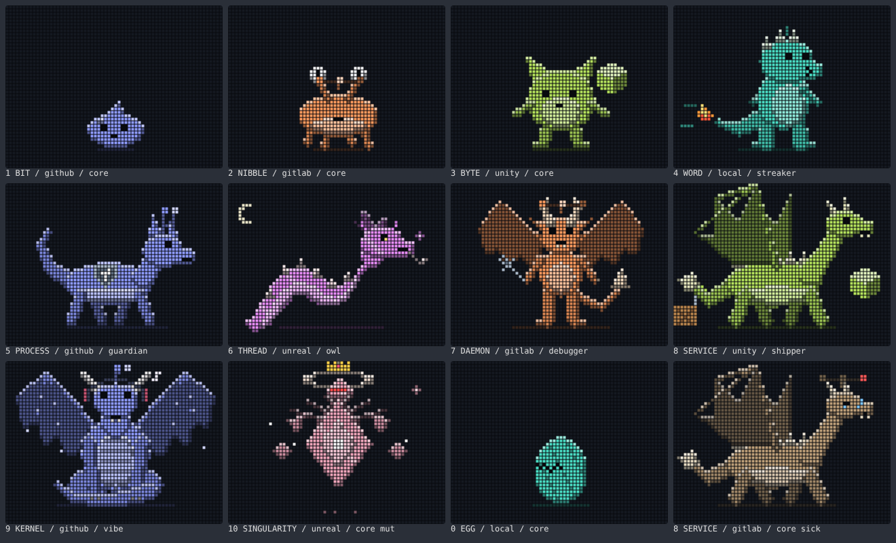
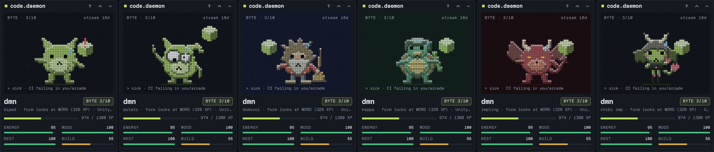
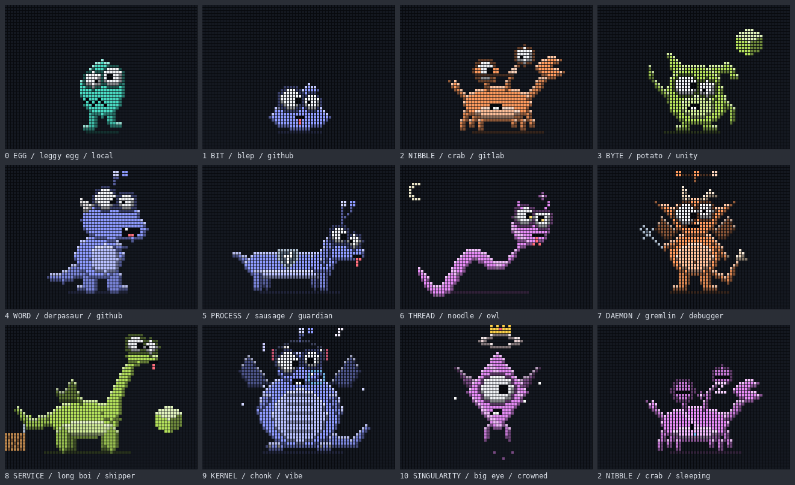
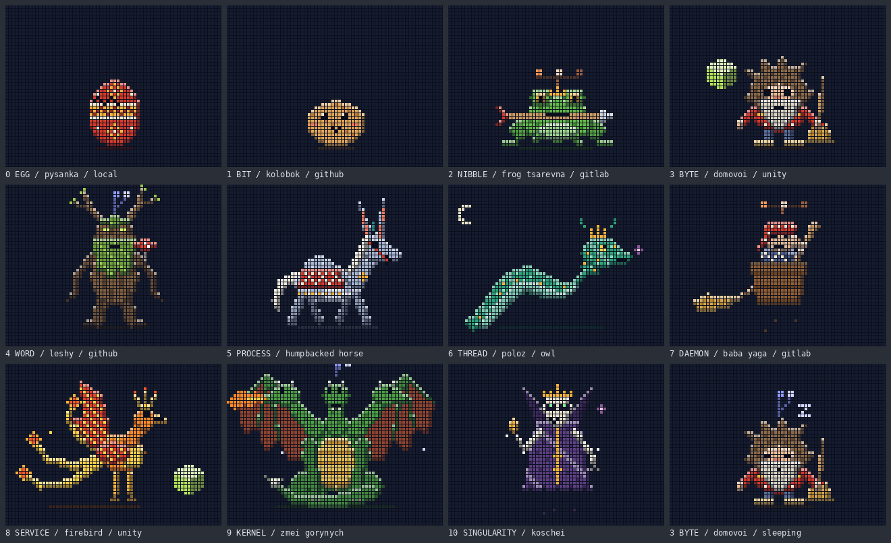
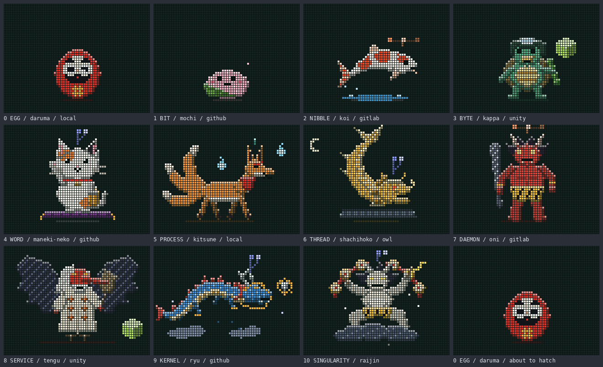
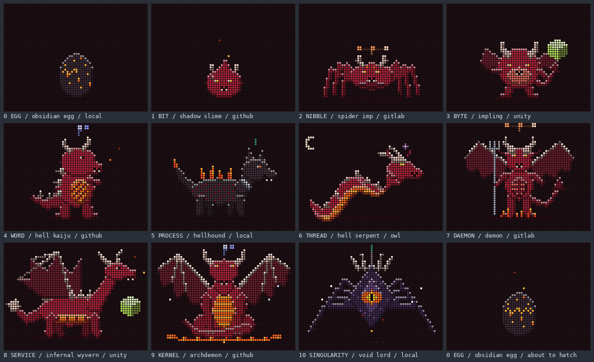
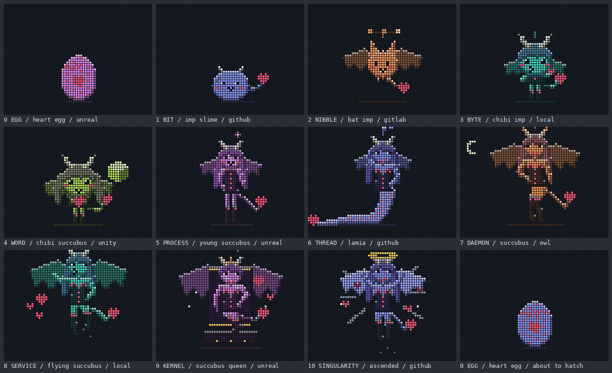

# code.daemon

A pixel pet for Windows that grows from your coding habits. It reads your commits, CI results and releases from GitHub and GitLab, then hatches, evolves and changes form based on how you actually work.



## What's here

| Path | What it is |
| --- | --- |
| `CodeDaemon.ps1` | Widget host: frameless always-on-top window (PowerShell 5.1 + Edge WebView2), tray icon, DPAPI-encrypted tokens, GitHub/GitLab API proxy |
| `ui/widget.html`, `ui/widget.js` | Widget UI: pet screen, vitals, Feed / Log / Setup / Wiki panel |
| `ui/wiki.js` | In-widget wiki: every mechanic, with the pet's live numbers (open with **?** or by clicking a vital) |
| `ui/i18n.js`, `ui/i18n/` | Translations: English, Russian, Spanish, German, Portuguese (Brazil), Chinese (Simplified), Korean, Japanese |
| `src/` | Pet engine source: `core/` (XP, hunger, stages, forms, mutations, CI health, GitHub scan), `render/` (pixel renderer in layers, theme registry, click reactions, the hungry look, SVG card), `themes/` (one file per theme) |
| `ui/pet-core.js` | The engine as one file for the widget, built from `src/` by `tools/build.cjs` (`npm run build`) |
| `github-profile/` | GitHub Action that puts the same pet, animated, on your GitHub profile |
| `lib/` | Microsoft WebView2 SDK (WinForms) and native loaders |
| `tools/build.cjs` | Builds `ui/pet-core.js` and the profile Action's copy of the engine |
| `tests/` | Engine, profile Action and widget tests: `npm install`, then `npm test` (Node 22+) |

## Run the widget

1. Double-click `Start code.daemon.vbs`. The pet appears in the bottom-right corner, with a tray icon.
2. In **Setup**, paste a GitHub token and/or a GitLab token (`read_api` + `read_user`). For GitHub a fine-grained token with read-only Contents, Metadata, Commit statuses and Actions is safest; it covers one owner. A classic token with `repo` sees every repo but can also write to them. The widget host only lets the page send read-only GraphQL queries to GitHub and GET requests to the GitLab API.
3. The first scan reads 180 days. After that it rescans every 15 minutes.

If nothing appears, run `Start code.daemon (debug).cmd` to see errors. Requires Windows 10/11 with the WebView2 Runtime.

## How the pet grows

- **XP per session**: commits in one repo less than 2 hours apart form a session. A session earns `12·ln(1 + minutes/20) + 7·√commits` (minutes up to 480, commits up to 50), plus 8 for tests, 6 for a bug fix and 15 for a release. Long sessions and commit bursts grow slowly on purpose.
- **Streak**: +3% per consecutive coding day, up to +30%.
- **Daily soft cap**: past 90 XP in a day, extra XP counts at 15%. Marathon days still count, they just can't carry the pet alone.
- **CI**: turning a red build green on the same branch earns +15 XP, at most once a day per repo. It counts toward the daily soft cap.
- **Commits** are matched by author email (on GitLab, by name only when it shows no email). A commit rebased or cherry-picked onto another branch counts once.
- **Rescans**: the widget re-reads the last 3 days on every scan, starting at the beginning of a session so none is cut in two. A repo that fails to scan keeps its saved sessions until the next scan.
- **Hunger**: a pet nobody codes for gets hungry and loses XP. It starts starving once 3 days have passed since the last session *and* Energy is down to 5 (so a week of long days keeps it fed for about a week). Hunger grows to full over 7 days; full hunger eats 4% of the stage's XP band a day, at most 25 XP. XP never drops under the stage's threshold: after 3 days at the bottom the pet **devolves**, landing two days of hunger under the top of the stage below, and keeps going down to the egg, which only cools. Forms of the lost stages are forgotten, so the next evolution picks a new one. One session ends it; a fixed build adds XP but doesn't feed it. A week off costs next to nothing, a month off a week or two of coding.

| Stage | XP | Body |
| --- | ---: | --- |
| 0 EGG | 0 | Egg |
| 1 BIT | 60 | Slime droplet |
| 2 NIBBLE | 250 | Crawler with eye stalks |
| 3 BYTE | 650 | Round biped |
| 4 WORD | 1,300 | Little kaiju with a tail |
| 5 PROCESS | 2,300 | Four-legged runner |
| 6 THREAD | 3,800 | Slithering wyrm |
| 7 DAEMON | 5,800 | Winged imp |
| 8 SERVICE | 8,500 | Wyvern |
| 9 KERNEL | 13,000 | Great dragon |
| 10 SINGULARITY | 30,000 | Ascended form |

Rough pace: a heavy daily vibe-coding habit reaches KERNEL in about 6 months and SINGULARITY in about 9; one solid session on weekdays reaches SERVICE in about a year.

- **Crest** (from NIBBLE): the source with the most XP in 30 days. GitHub branch antenna, GitLab pipeline crest, Local `>_` mouth, Unity companion cube, Unreal material sheen. Unity and Unreal repos are detected from `ProjectSettings/` + `Assets/` and `*.uproject`.
- **Forms** (from WORD): every evolution locks a form from your last 30 days. Guardian (tests, shield), Debugger (bug fixes, wrench), Night Owl (late nights, moon and glowing eyes), Shipper (releases, crate), Streaker (7+ day streak, fire), Polyglot (4+ sources, stripes), Vibecoder (10+ commits per session, headphones and notes), or Core.
- **Mutations**, from the last 365 days: Shiny (30-day streak), Cursed (coded on a Friday the 13th), Crowned (10,000 XP earned), Committed (1000 commits: your real contribution graph of the last 29 weeks, dim on the wall behind the pet). Earned again every year, lost a year after the last time.
- **Vitals**: Energy (recent minutes, 24 h half-life), Mood (streak, variety, tests and fixes), Rest (sessions ending 23:00–05:00 and marathons), Health (CI health of repos touched in 14 days; a red build makes the pet sick).
- **Looks**: below Energy 20 the pet sleeps and looks worn out in every theme: a thinner body and limbs, ribs, sunken eyes, faded colors. Starving makes all of it stronger, a pet about to devolve flickers, and a devolution plays its own animation.

The pet is drawn on a 64 × 48 dot-matrix grid from shaded body parts, so each stage has its own silhouette and animation (bouncing, walking, slithering, wing flaps, floating).

## Themes



Pick one in **Setup → Theme**. The choice is saved with the pet. XP, stages, forms and vitals are the same in every theme; only the look changes.

| Theme | Look | Stages |
| --- | --- | --- |
| Classic | Shaded creatures in your affinity color | slime → crawler → biped → kaiju → runner → wyrm → imp → wyvern → dragon → ascended |
| Derpy | The Classic line drawn badly on purpose: googly eyes that wander off on their own, buck teeth, tongues out | leggy egg → blep → crab → potato → derpasaur → sausage → noodle → gremlin → long boi → chonk → big eye |
| Slavic | Characters from Slavic fairy tales in their own colors, with folk ornament, on a night-blue screen | pysanka → kolobok → frog tsarevna → domovoi → leshy → humpbacked horse → poloz → Baba Yaga → firebird → Zmei Gorynych → Koschei |
| Asian | Creatures from Japanese and Chinese folklore in their own colors, on an ink-green screen | daruma → mochi → koi → kappa → maneki-neko → kitsune → shachihoko → oni → tengu → ryu → Raijin |
| Demonic | The line from hell in crimson and obsidian, lava glowing through, on a dark red screen | obsidian egg → shadow slime → spider imp → impling → hell kaiju → hellhound → hell serpent → demon → infernal wyvern → archdemon → void lord |
| Succubus | A little imp who grows up into a succubus queen; skin in your affinity color, hair, wings and outfit in darker shades of it | heart egg → imp slime → bat imp → chibi imp → chibi succubus → young succubus → lamia → succubus → flying succubus → succubus queen → ascended |

Derpy keeps everything Classic has, including the crests, and adds its own bits: drool, a forked tongue, a fiddler-crab claw, a snot bubble on the chonk.



Slavic creatures keep their own colors (a golden kolobok, a green frog, a red-winged firebird); your affinity shows in the crest above the head, as in Classic. Extras: the pysanka cracks as it gets close to hatching, the frog holds Ivan's arrow, Gorynych's side heads take turns breathing fire, Koschei holds up the egg his death is hidden in.



Asian creatures also bring their own colors, with the crest above the head. The koi climbs the Dragon Gate as the line goes on: it comes back as a golden shachihoko on a castle roof and then as a dragon. Extras: the daruma gets its first eye painted at your first commit and the second one fills in as it gets close to hatching, the maneki-neko beckons, the kitsune has three tails and foxfire, the dragon chases a flaming pearl, Raijin strikes his drums in turns and lightning jumps out of them.



Demonic creatures bring their own colors, with your affinity in the crest. Their eyes glow, embers drift off them, the egg cracks with lava light, the hellhound's back is on fire, the demon stands in flames with a trident, the archdemon sits in a ring of fire, and the void lord stares out of a crystal with one burning eye.



Succubus follows your affinity: skin in its color, wings, hair and outfit in darker shades of it, pink hearts on top. She goes from a heart-dotted egg and a blob with a heart-tipped tail to a chibi imp, and from the lamia on she is grown up: bare shoulders over a corset with a sweetheart neckline, thigh-high boots with pink garters, painted lips, a hand on her hip. Then she flies with hearts trailing behind, sits cross-legged on a gold-trimmed throne as the queen, and ascends in a burst of light.



Every theme answers clicks: pat the head, tickle the belly, poke a leg, a tail or a wing, and the pet reacts; when it evolves it jumps for joy in a burst of stars. Drag the screen to move the widget as before.

### Adding a theme

Every theme is one file in `src/themes/` that draws its creatures from shapes (ellipses, tapered limbs, polygons), frame by frame, so it animates, takes forms, crests and status effects, and can react to clicks like the rest. The registry (`src/render/themes.js`) documents every field; `src/render/build.js` lists the layers a frame is drawn in.

1. Copy the theme closest to what you want (`classic.js` for affinity colors, `slavic.js` for creatures with their own colors, `succubus.js` for colors derived from the affinity) to `src/themes/<id>.js`.
2. Change `id`, `name`, `accent` (its chip color), optionally `screen`/`dot` and `bodies`, and redraw the 11 stages in `plans()`.
3. Add `defineTheme(require('./themes/<id>'));` to `src/index.js` and run `npm run build`.
4. Add `theme.<id>` and `body.<id>.0`–`10` to each `ui/i18n/<lang>.js`; `npm test` lists what is missing and checks every stage in every state.

### Adding an animation

Animations are clips: data in `src/render/clips.js`, not code in each theme. A clip has a length in ticks (8 per second) and channels, each a constant, an array per tick or a function of the tick: the body's offset and squash (`ox`, `oy`, `sq`), the motion phases themes draw with (`bob`, `walk`, `flap`, `sway`...), a face and a mouth expression, and an effect (`fx`). A new clip plays in every theme at once:

```js
hop: {len: 10, oy: [0, -2, -4, -5, -5, -4, -2, 0, 0, 0], sq: [1, 1, 1, 1, 1, 1, 1, 0.88, 0.95, 1], face: t => (t < 7 ? 'wow' : 'joy'), walk: t => t & 1}
```

Add one to `CLIPS` (or call `PetCore.defineClip(name, clip)`) and play it with `build(D, f, {clip: {name, t}})`; the widget plays `evolve` when the pet evolves, `devolve` when hunger costs it a stage, and a reaction when you click it. Idle, sleep and the weak bounce of a critically sick pet are clips too (`BASE`). A theme can bring its own version of any clip in `clips`.

## Languages

**Setup → Language** picks the interface language (or *System*, which follows Windows) and, separately, the wiki language (or *Same as interface*). Both are saved with the pet; the tray menu follows the interface. The GitHub profile card stays in English.

To add a language, copy `ui/i18n/en.js` to `ui/i18n/<id>.js`, translate it together with the `data-i18n*` texts in `widget.html` and the stage, body, form and theme names (`npm test` lists every key that is missing), add it to `LANGS` in `ui/i18n.js` and a `<script>` tag in `widget.html`.

## GitHub profile pet

See [`github-profile/SETUP.md`](github-profile/SETUP.md). Copy `github-profile/.github` into your `<you>/<you>` repo and add `` to its README. Set `PET_THEME` in the workflow to `classic`, `derp`, `slavic`, `asian`, `demonic` or `succubus`.

## Releases

Run **Actions → release → Run workflow**, select the branch to release, and enter a version such as `v1.2.3`. The workflow builds the engine, runs the tests, and publishes a release whose title and tag exactly match the version. The tag is created at the selected commit; an existing tag must point to that same commit. Existing releases are never overwritten. If an upload or publication fails after a draft is created, inspect/delete that draft before retrying.

Release assets:

- `code-daemon-<version>.zip`: the desktop host, normal VBS launcher, UI, fonts with their licenses, and WebView2 libraries. Tests, the debug launcher, engine sources, profile Action, documentation and development files are excluded.
- `code-daemon-<version>.SHA256-<hash>.txt`: the ZIP's SHA-256 in both the filename and its contents (`<hash>  <archive name>`).

Extract the ZIP and double-click `Start code.daemon.vbs`. Windows 10/11 and the WebView2 Runtime are required. GitHub also adds its own source archives; use the `code-daemon-<version>.zip` asset for the runtime package.

To package locally, run `npm run build`, then `./tools/package-release.ps1 -Version v1.2.3` in PowerShell. Assets are written to `dist/`; existing ZIPs are not overwritten.

## Development

The engine lives in `src/` as plain CommonJS modules. `npm run build` bundles it into `ui/pet-core.js` (loaded by the widget with a `<script>` tag) and copies it to `github-profile/.github/code-daemon/`. Never edit those two generated files by hand; `npm test` fails while they are out of date. No dependencies besides Node 22+.

`npm test` runs the tests. `tests/host.tests.ps1` checks `CodeDaemon.ps1` (parse, file writer, query filter); CI runs it with Windows PowerShell 5.1.

## Data

- `%APPDATA%\CodeDaemon\save.json`: pet, sessions, repo list, CI state (`save.json.bak` is the previous version)
- `%APPDATA%\CodeDaemon\settings.json`: tokens (DPAPI, current user only), window position
- `%LOCALAPPDATA%\CodeDaemon\host.log`: errors

## Third-party

Microsoft WebView2 SDK (`lib/`). Geist Mono and Martian Mono fonts under the SIL Open Font License (`ui/fonts/`).
